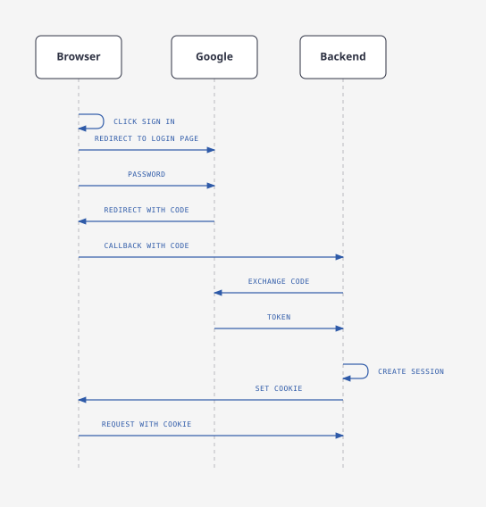
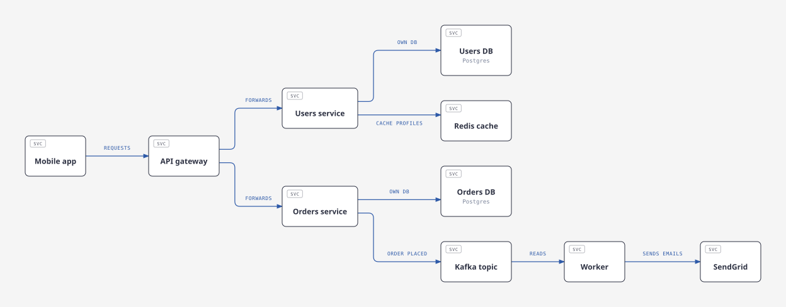
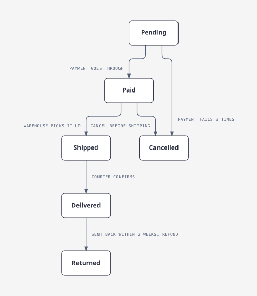
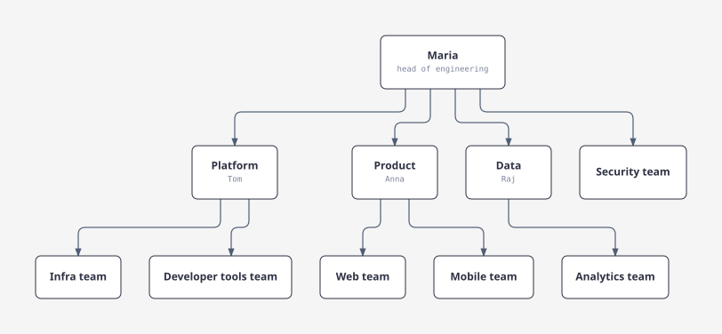

# elbow

Draws diagrams as editorial SVG in the `diagram-design` style: layered layout, orthogonal connectors with rounded
elbows, masked labels, bridges where lines cross, and a legend. The six connector rules are checked on every render.

A model chooses the content and a few typed parameters. elbow does all the geometry in about 1 ms.

## Previews

| Sequence | Flow |
| --- | --- |
|  |  |
| **State** | **Tree** |
|  |  |

The example inputs are in [`tests/`](tests).

## Diagram types

Set `kind` to one of these.

| `kind` | Use it for | Layout |
| --- | --- | --- |
| `flow` | Steps, services and the connections between them | Layered, left to right, with technical node tags |
| `sequence` | Messages between actors, in time order | Lifelines with messages |
| `state` | States and the transitions between them | Layered |
| `tree` | Hierarchies, such as an org chart | Layered, top down; sync edges drawn as data |
| `er` | Entities and the relationships between them | Layered |
| `swimlane` | Steps grouped by owner or team | One lane per group |
| `nested` | Groups inside groups | Layered |
| `layers` | A stack of layers, such as an architecture stack | Layered, top down |
| `dependency` | What depends on what | Layered, with technical node tags |

`--best` can choose another direction when it scores better.

## Usage

```powershell
cargo build --release
target\release\elbow.exe view.json --best --out diagram.html --report
target\release\elbow.exe view.json --variants            # every candidate with its score
target\release\elbow.exe view.json --params '{"direction": "down", "theme": "dark"}' --out diagram.svg
```

`--best` renders a grid of parameter sets and keeps the best score. `--report` prints the rule violations and the
measures (crossings, bends, unclear labels, area) to stderr.

## Input

```json
{
  "number": 1,
  "title": "Login with Google",
  "kind": "sequence",
  "nodes": [{"id": "browser", "label": "Browser (web app)", "shape": "client", "focal": false}],
  "edges": [{"source": "browser", "target": "google", "label": "redirect", "style": "sync", "focal": false}],
  "groups": [{"id": "team", "label": "Team", "members": ["browser"]}]
}
```

- `kind`: one of the [diagram types](#diagram-types).
- `shape`: `service`, `database`, `queue`, `cache`, `actor`, `external`, `client`, `state`, `decision`, `note`.
- `style`: `sync`, `async`, `data`, `transition`, `dependency`.
- A trailing `(…)` in a node label becomes its sublabel. In a swimlane, groups become lanes.
- `focal` marks the 1–2 elements the reader should look at first; a node or an edge.

## Parameters

`direction` (`right`, `down`), `node_gap`, `min_channel`, `track_gap`, `uniform_rank_size`, `ordering_sweeps`,
`theme` (`light`, `dark`), `legend`.

## Tests

```powershell
cargo test --release
cargo run --release --example stress 500 --best
```

## Credits

The editorial look follows the [diagram-design](https://github.com/cathrynlavery/diagram-design) skill by Cathryn Lavery. Credit for the visual style goes to that project.
