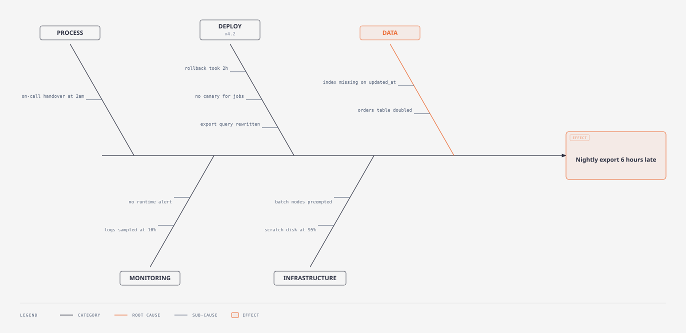
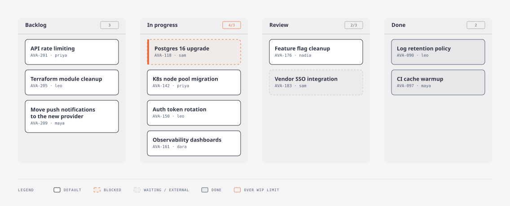
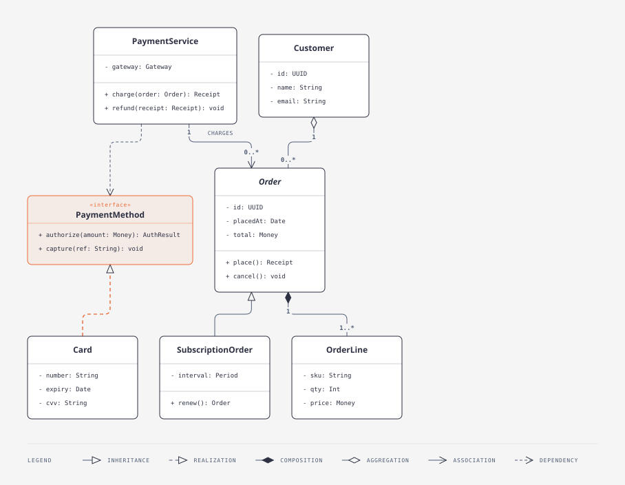
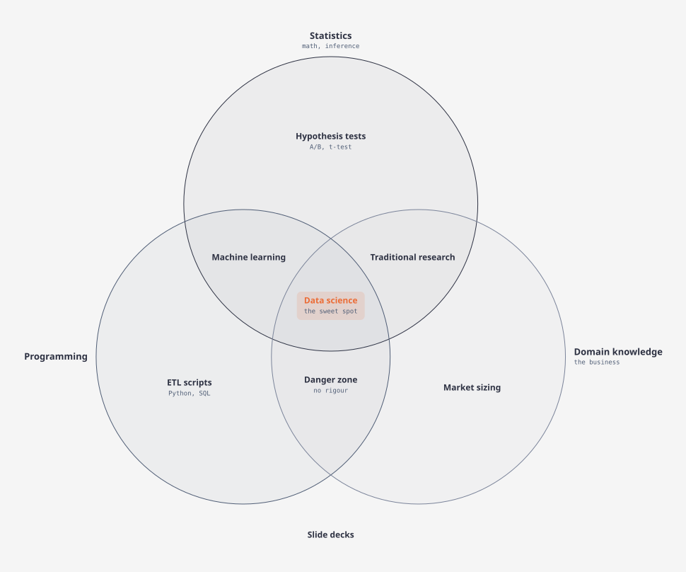

# elbow

Draws diagrams as editorial SVG in the `diagram-design` style: layered layout, orthogonal connectors with rounded
elbows, masked labels, bridges where lines cross, and a legend. The six connector rules are checked on every render.

A model chooses the content and a few typed parameters. elbow does all the geometry in about 1 ms.

## Previews

| Sequence | Flow |
| --- | --- |
|  |  |
| **State** | **Tree** |
|  |  |
| **Fishbone** | **Kanban** |
|  |  |
| **UML class** | **Venn** |
|  |  |

The example inputs are in [`tests/`](tests).

## Diagram types

Set `kind` to one of these.

| `kind` | Use it for | Layout |
| --- | --- | --- |
| `flow` | Steps, services and the connections between them | Layered, left to right, with technical node tags |
| `sequence` | Messages between actors, in time order | Lifelines in node order, with activation bars |
| `state` | States and the transitions between them | Layered |
| `tree` | Hierarchies, such as an org chart | Layered, top down; sync edges drawn as data |
| `er` | Entities and the relationships between them | Layered; fields from `Name (id, name, …)`, cardinality from `1:N` labels |
| `swimlane` | Steps grouped by owner or team | One lane per group |
| `nested` | Groups inside groups | Rings in rings |
| `layers` | A stack of layers, such as an architecture stack | Full-width bands, numbered from the bottom |
| `dependency` | What depends on what | Top down, with fan-in badges; a cycle is the accent |
| `timeline` | Events, releases or milestones in time | Dots on a baseline, `Name (date)`; groups are periods |
| `process` | A business process by role, with handoffs | Role lanes, steps numbered per rank |
| `loop` | A cycle or flywheel | Stations clockwise on a ring; the first store is the hub |
| `pyramid`, `funnel` | Ranked levels, or stages that narrow | Layers, top first |
| `venn` | Overlapping sets and what they share | Two or three circles; groups are the sets |
| `fishbone` | The causes of one problem | Effect, categories and sub-causes as bones |
| `kanban` | Work items by status | Columns `Name (WIP limit)`, cards `Title (ticket · owner)` |
| `journey` | One person's stages and feelings | A sentiment curve, `Stage (feeling, touchpoint)` |
| `story-map` | User activities and stories, by release | Activity backbone over release slices |
| `uml-class` | Classes and their relationships | Class boxes `Name (+ attr: T, + op(): R)` |
| `deployment` | Where software runs | Hosts `Name (POD, image v1, x3)` in dashed zones |
| `medallion` | Data tiers a dataset is promoted through | Tier cards `Tier (bucket; tool; format; writer)` |
| `org-chart` | Who owns what and who reports to whom | Owners over reports on bus connectors |
| `db-schema` | Tables, typed columns and foreign keys | Tables `schema.table (col type PK, …)`, keys row to row |
| `quadrant` | Items sorted by two criteria | A two-by-two grid; axis words from an `A vs B` title |
| `wardley` | A value chain by evolution | Components `Name (stage)` on the evolution axis |

`--best` can choose another direction when it scores better.

## Usage

```powershell
cargo build --release
target\release\elbow.exe view.json --best --out diagram.html --report
target\release\elbow.exe view.json --variants            # every candidate with its score
target\release\elbow.exe view.json --params '{"direction": "down", "theme": "dark"}' --out diagram.svg
```

`--best` renders a grid of parameter sets and keeps the best score. `--report` prints the rule violations and the
measures (crossings, bends, unclear labels, area) to stderr.

## Input

```json
{
  "number": 1,
  "title": "Login with Google",
  "kind": "sequence",
  "nodes": [{"id": "browser", "label": "Browser (web app)", "shape": "client", "focal": false}],
  "edges": [{"source": "browser", "target": "google", "label": "redirect", "style": "sync", "focal": false}],
  "groups": [{"id": "team", "label": "Team", "members": ["browser"]}]
}
```

- `kind`: one of the [diagram types](#diagram-types).
- `shape`: `service`, `database`, `queue`, `cache`, `actor`, `external`, `client`, `state`, `decision`, `note`.
- `style`: `sync`, `async`, `data`, `transition`, `dependency`.
- A trailing `(…)` in a node label becomes its sublabel. In a swimlane, groups become lanes.
- `focal` marks the 1–2 elements the reader should look at first; a node or an edge.
- `selected` (ids) and `pointed` (one id) mark nodes, edges or sections. Every node, edge and section is a
  `[data-id]` group, so a page can select and point at it.

## Parameters

`direction` (`right`, `down`), `node_gap`, `min_channel`, `track_gap`, `uniform_rank_size`, `ordering_sweeps`,
`theme` (`light`, `dark`), `legend`.

## Benchmark

Against an agent that draws the same diagram by hand with diagram-design ([details](docs/benchmark.md)):

| | Hand-drawn | elbow |
| --- | ---: | ---: |
| Agent tokens, 4 diagrams | 318,079 | 197,033 (38% fewer) |
| Agent time, 4 diagrams | 439 s | 91 s (4.8x faster) |
| Model output, 14 diagrams | 53,880 tokens of SVG | 7,102 tokens of JSON (7.6x less) |
| Render time | — | 16–41 ms per diagram with `--best` |

Sequence and flow diagrams come out as clean as the hand-drawn ones; nested and swimlane layouts still have more
crossings than a careful hand drawing.

## Use with an AI agent

[`skills/elbow-diagram`](skills/elbow-diagram/SKILL.md) is an Agent Skill that teaches an agent to draw with
elbow: which kind to pick, how to write the view and its label conventions, how to read the report, and a script
that puts several diagrams on one page. Copy the folder into your agent's skills folder, or point the agent at
its `SKILL.md`. Agents working in this repo start from [AGENTS.md](AGENTS.md).

## Tests

```powershell
cargo test --release
cargo run --release --example stress 500 --best
```

## Credits

The editorial look follows the [diagram-design](https://github.com/cathrynlavery/diagram-design) skill by Cathryn Lavery. Credit for the visual style goes to that project.
